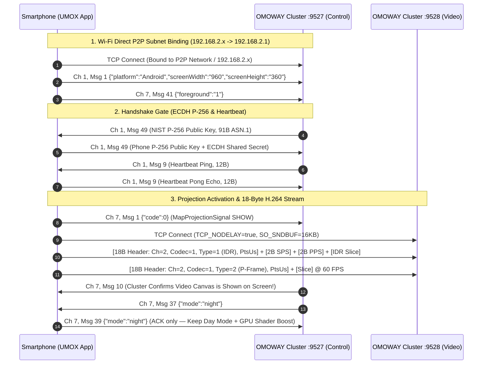

# OMOWAY Headunit & Speedometer Protocol Wiki

> **Reverse-Engineering & Technical Specifications for OMOWAY Smart Electric Motorcycle Cluster (Desay SV MapCast Architecture & 60 FPS Zero-Delay Android Auto Streaming)**

Repository ini mendokumentasikan spesifikasi teknis, arsitektur jaringan, reverse engineering protokol **Desay SV**, serta solusi lengkap untuk mengalirkan **Android Auto & Navigasi 60 FPS tanpa delay** langsung ke speedometer/headunit pintar motor listrik OMOWAY tanpa ketergantungan pada aplikasi resmi OMOWAY maupun AutoNavi (AMAP).

---

## 📌 Ringkasan Cepat (Cheat Sheet)

| Parameter | Nilai / Spesifikasi | Keterangan |
| :--- | :--- | :--- |
| **Vendor Headunit** | **Desay SV Automotive** | Firmware cluster berbasis Linux Embedded |
| **Protokol Video** | **18-Byte Desay SV H.264 Framing over TCP** | **BUKAN RTSP** & **BUKAN 8-Byte Polos** (Wajib 8B Outer + 10B Inner Header) |
| **Resolusi Canvas Video** | **960 x 360 piksel** | Rasio ultra-wide (`8:3`), 140–160 DPI |
| **Area Aman HUD (Safe Margin)** | **840 x 270 piksel** (`glViewport(0, 45, 840, 270)`) | Menghindari tumpang tindih dengan angka `0 km/h` (Kanan 120px), Jam (Atas 45px), & Baterai (Bawah 45px) |
| **Framerate & Bitrate** | **60 FPS**, **4.000.000 bps (4 Mbps CBR)** | `AVCProfileBaseline`, `GOP = 6 frames` (`I_FRAME_INTERVAL = 0`, IDR tiap 100ms) |
| **Port Video Stream** | **TCP Port 9528** | `Channel = 2`, `Codec = 1`, `Type = 1 (IDR) | 2 (P)`, `PtsUs`, 2B Length-Prefixed SPS/PPS |
| **Port Kontrol (Control)** | **TCP Port 9527** | Desay SV Dual-Channel Binary & JSON Framing (`Channel 1` System & `Channel 7` Projection/Telemetry) |
| **Buffer & Antrean Video** | **`SO_SNDBUF = 16 KB` + `100 ms` Bounded Queue** | Mencegah bufferbloat kernel TCP & menjamin pemulihan instan via **750 ms Write Watchdog** |
| **Kompensasi Layar Redup** | **GPU Fragment Shader (Daylight Anti-Overlay)** | Mengangkat `Gamma (0.68)`, `Brightness (+14%)`, `Contrast (1.32x)`, `Saturation (1.35x)` untuk melawan *dark overlay* bawaan OMOWAY |
| **Topologi Jaringan** | **Wi-Fi Direct (P2P)** | Cluster bertindak sebagai **Group Owner (GO)** pada **5745 MHz (Channel 149)** |
| **Default IP Headunit** | **`192.168.2.1`** | Server TCP Port `9527` (Control) & `9528` (Video) |
| **Default IP Client (HP)**| **`192.168.2.x`** (`p2p-wlan0-*`) | Socket wajib di-bind eksplisit ke interface/IP lokal subnet `192.168.2.x` |
| **Baud Rate CAN Bus** | **500.000 bps (500 kbps)** | Standar CAN 2.0A (11-bit ID, ~870 fps, 40 IDs) |

---

## 🔑 6 Kunci Utama Mengapa Streaming ke Desay SV Akhirnya Berjalan Smooth (60 FPS Zero Delay)

1. **Struktur Header Video 18-Byte (Bukan 8-Byte)**:
   Port `9528` menggunakan **8-byte Outer Header** (`channel = 2`, `inner_len`) ditambah **10-byte Inner Video Header** (`codec = 1 [1B]`, `frame_type = 1 (IDR) | 2 (P) [1B]`, `pts_us [8B int64 LE]`). Khusus untuk IDR KeyFrame (`frame_type = 1`), `SPS` dan `PPS` wajib disisipkan di awal payload dengan awalan panjang 2-byte Little-Endian (`[spsLen (2B)][SPS][ppsLen (2B)][PPS][IDR Slice]`).
2. **Gate Handshake Port 9527 & `awaitingFirstKeyFrame`**:
   Saat terhubung ke Port `9527`, HP mengirim `Ch 1, Msg 1` (`{"platform":"Android","screenWidth":"960","screenHeight":"360"}`) dan `Ch 7, Msg 41` (`{"foreground":"1"}`), lalu **menunggu** `Ch 1, Msg 49` (ECDH P-256) atau `Ch 1, Msg 9` (Ping) sebelum mengirim `Ch 7, Msg 1` (`{"code":0}`) dan membuka Port `9528`. Paket pertama yang dikirim ke Port `9528` **wajib** berupa IDR KeyFrame (`frame_type = 1`).
3. **GOP Ultra-Pendek (100 ms / Setiap 6 Frame) & 60 FPS**:
   Mengatur `KEY_I_FRAME_INTERVAL = 0` dan memicu `PARAMETER_KEY_REQUEST_SYNC_FRAME` setiap 100 ms membuat ukuran IDR frame jauh lebih rata dan kecil (~8–15 KB), serta memungkinkan decoder headunit pulih dalam `< 100 ms` jika terjadi gangguan radio.
4. **Anti-Bufferbloat (`16 KB SO_SNDBUF` + `100 ms Bounded Queue` + `750 ms Write Watchdog`)**:
   Membatasi buffer kirim OS hanya `16 KB` dan antrean aplikasi maksimal `100 ms` memastikan frame lama langsung dibuang (*drop oldest*) dan meminta IDR baru, sehingga latensi kaca-ke-kaca (*glass-to-glass*) selalu `< 30 ms`.
5. **HUD Safe Margin (`840x270` di dalam `960x360`)**:
   Menggeser viewport OpenGL ke `x=0, y=45, w=840, h=270` membebaskan tampilan peta dari tumpukan angka speedometer `0 km/h` di kanan (`120 px`), jam di atas (`45 px`), dan indikator baterai di bawah (`45 px`).
6. **GPU Daylight Anti-Overlay Shader & Pencegahan False Night Mode (`Ch 7, Msg 37`)**:
   Speedometer OMOWAY sering mengirim `Ch 7, Msg 37 {"mode":"night"}` bahkan di pagi/siang hari dan memberi lapisan gelap transparan di atas video. Dengan membalas `Ch 7, Msg 39 {"mode":"night"}` sebagai ACK tanpa memaksa Google Maps ke mode malam, ditambah **Fragment Shader OpenGL ES 2.0** yang mengangkat Gamma, Brightness, Contrast, dan Saturasi, tampilan peta di siang terik menjadi sangat terang dan jelas.

---

## 📐 Arsitektur Urutan Protokol (Sequence Diagram)

---

## 📚 Daftar Dokumen Spesifikasi

1. **[Spesifikasi Video Streaming Port 9528 (60 FPS Zero-Delay)](docs/video-streaming.md)**  
   Struktur **18-byte Video Header** (`8B Outer + 10B Inner`), injeksi `2B Length-Prefixed SPS/PPS` pada IDR frame, konfigurasi encoder `60 FPS / GOP 6`, `16 KB SO_SNDBUF`, **HUD Safe Margin (`840x270`)**, dan **GLSL Daylight Anti-Overlay Shader**.

2. **[Spesifikasi Protokol Kontrol Port 9527](docs/protocol-specification.md)**  
   Format framing biner, state-machine startup (`Ch 1, Msg 1` + `Ch 7, Msg 41`), gate `confirmReady()` (`Msg 49` ECDH / `Msg 9` Ping), `Ch 7, Msg 1` (Show), `Ch 7, Msg 10/11` (Display Shown/Hidden + 250ms auto-recovery), dan penanganan `Ch 7, Msg 37 -> Msg 39`.

3. **[Arsitektur Native Android Auto Receiver & HUD Cockpit](docs/android-auto-hud.md)**  
   Cara kerja receiver loopback `127.0.0.1:5277`, probe `ServerSocket EADDRINUSE` tanpa mematikan `GH.DHUService`, 5-channel `ServiceDiscoveryResponse` (`1280x720@60fps` margin `160x360`), serta pipeline OpenGL ES 2.0 `EglSurfaceCropper`.

4. **[Spesifikasi Jaringan Wi-Fi Direct (P2P)](docs/network-and-wifi-direct.md)**  
   Topologi Group Owner `192.168.2.1`, eksplisit socket binding ke interface `p2p-wlan0-*`, dan deteksi konflik aplikasi resmi `com.omoway.app.android`.

5. **[Spesifikasi Protokol CAN Bus](docs/canbus-protocol.md)**  
   Spesifikasi layer fisik 500 kbps, matriks 40 CAN ID kendaraan, decoding tegangan 24 sel baterai BMS (LFP 24S ~78.9V), probe suhu baterai, rolling counter & CRC safety.

6. **[Web Dashboard & Visual Telemetry Cockpit](web-dashboard/index.html)**  
   Dashboard web interaktif real-time berbasis dark glassmorphism untuk memonitor status rem, regen torque, Odometer/Trip/Range, DRL Headlight Array, tegangan 24-sel BMS, serta live frame sniffer.

---

## 👥 Repositori Terkait
* **[OMO-X/AboutOMO](https://github.com/OMO-X/AboutOMO)**: Dokumentasi teknis & wiki protokol speedometer OMOWAY.
* **[OMO-X/umox-app](https://github.com/OMO-X/umox-app)**: Implementasi aplikasi Android native (Kotlin) untuk Android Auto Receiver, HUD Safe Margin, & GPU Daylight Booster.
