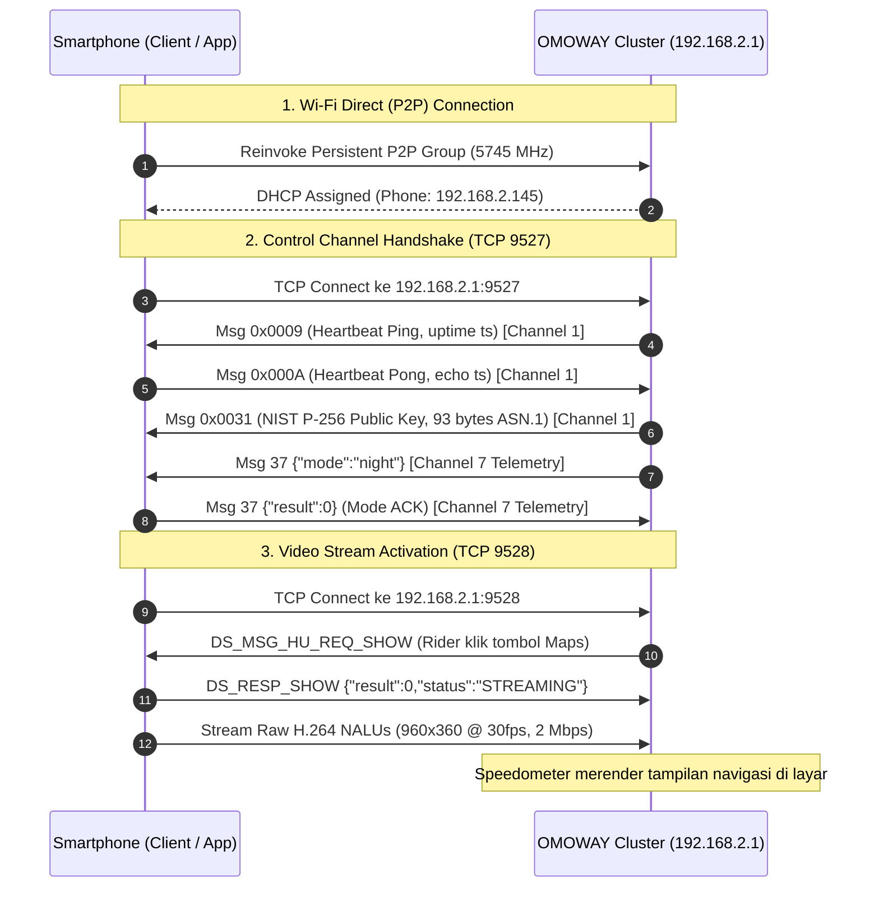

# OMOWAY Headunit & Speedometer Protocol Wiki

> **Reverse-Engineering & Technical Specifications for OMOWAY Smart Electric Motorcycle Cluster (Desay SV MapCast Architecture)**

Repository ini mendokumentasikan spesifikasi teknis, arsitektur jaringan, reverse engineering protokol, serta referensi implementasi lengkap untuk berinteraksi langsung dengan speedometer/headunit pintar motor listrik OMOWAY secara independen tanpa ketergantungan pada aplikasi resmi OMOWAY maupun AutoNavi (AMAP).

Dokumentasi ini dirancang agar AI agent atau pengembang dapat membangun kembali aplikasi integrasi (seperti HUD mirror, Google Maps cast, telemetry sniffer) dari awal (from scratch).

---

## 📌 Ringkasan Cepat (Cheat Sheet)

| Parameter | Nilai / Spesifikasi | Keterangan |
| :--- | :--- | :--- |
| **Vendor Headunit** | **Desay SV Automotive** | Firmware cluster berbasis Linux Embedded |
| **Protokol Video** | **Raw H.264 AVC over TCP** | **BUKAN RTSP** (Port 554/8554 tidak dipakai) |
| **Resolusi Layar HUD** | **960 x 360 piksel** | Rasio ultra-wide (~8:3), 160 DPI |
| **Framerate & Bitrate** | **30 FPS**, **2.000.000 bps (2 Mbps CBR)** | Profile 8 (High/Baseline), I-frame interval 1s |
| **Port Video Stream** | **TCP Port 9528** | Raw Annex-B H.264 NALUs (`00 00 00 01`) |
| **Port Kontrol (Control)** | **TCP Port 9527** | Desay SV Dual-Channel Binary & JSON Framing |
| **Topologi Jaringan** | **Wi-Fi Direct (P2P)** | Cluster bertindak sebagai **Group Owner (GO)** |
| **Default IP Headunit** | **`192.168.2.1`** | Gateway & Server Port 9527/9528 |
| **Default IP Client (HP)**| **`192.168.2.145`** | Diperoleh via DHCP pada interface `p2p-wlan0-0` |
| **SSID Wi-Fi Direct** | **`DIRECT-OMO-xx-xx-xx`** | Dynamic suffix berdasarkan MAC perangkat |
| **MAC Address P2P** | **`<TARGET_P2P_MAC>`** | Disesuaikan dengan MAC P2P perangkat (format: `XX:XX:XX:XX:XX:XX`) |
| **Baud Rate CAN Bus** | **500.000 bps (500 kbps)** | Standar CAN 2.0A (11-bit ID, ~870 fps, 40 IDs) |
| **Hardware Sniffer** | **MKS CANable v2 Pro** | SLCAN command `S6` & `O` (Tanpa 120Ω jumper) |
| **Frekuensi Wi-Fi** | **5745 MHz (5 GHz, Band 4)** | Channel 149, 802.11ac/n |

---

## 📐 Arsitektur Sistem

---

## 📚 Daftar Dokumen Spesifikasi

1. **[Spesifikasi Protokol CAN Bus](docs/canbus-protocol.md)**  
   Spesifikasi layer fisik 500 kbps, matriks 40 CAN ID kendaraan, decoding tegangan 24 sel baterai BMS (LFP 24S ~78.9V), probe suhu baterai, rolling counter & CRC safety.

2. **[Spesifikasi Protokol Kontrol Port 9527](docs/protocol-specification.md)**  
   Format framing biner 8-byte, pembagian channel (Channel 1 System vs Channel 7 Telemetry), handshake NIST P-256 (`0x0031`), heartbeat (`0x0009`/`0x000A`), respon night mode (`Msg 37`), dan pesan JSON `DS_MSG_*`.

3. **[Spesifikasi Video Streaming Port 9528](docs/video-streaming.md)**  
   Format NALU Annex-B H.264, parameter encoder, konfigurasi SPS/PPS (`csd-0`, `csd-1`), bitrate, dan pola buffer canvas.

4. **[Spesifikasi Jaringan Wi-Fi Direct (P2P)](docs/network-and-wifi-direct.md)**  
   Topologi Group Owner, persistensi grup Android wpa_supplicant, addressing DHCP, dan penanganan bug invitation `Dropping connect request`.

5. **[Web Dashboard & Visual Telemetry Cockpit](web-dashboard/index.html)**  
   Dashboard web interaktif real-time berbasis dark glassmorphism untuk memonitor status rem, regen torque, Odometer/Trip/Range ground truth cluster, komponen fisik realistis **Addressable DRL Headlight Array (32 diode LED + PWM)**, tegangan 24-sel BMS, suhu baterai, serta live frame sniffer.  
   *Jalankan server via: `python web-dashboard/server.py` dan buka `http://127.0.0.1:8080` di browser.*

6. **[CAN Bus Sniffer & Logger Python](examples/omoway_can_sniffer.py)**  
   Skrip pencatat traffic CAN bus real-time ke format `.csv` dan `.candump.log` (kompatibel SavvyCAN).

7. **[Standalone Test Client Port 9527/9528](examples/python-test-client/mock_headunit_client.py)**  
   Skrip Python tanpa dependensi rumit untuk menguji komunikasi soket 9527 & 9528 langsung dari laptop atau shell ADB.

---

## 💡 Status Implementasi & Gotchas Penting

* **Bukan RTSP**: Aplikasi resmi OMOWAY tidak pernah menjalankan RTSP server. Stream video murni adalah soket TCP biasa di port 9528 yang menerima Annex-B H.264 raw packets secara terus-menerus.
* **Tampilan "Minta Hubungkan dengan Wi-Fi"**: Peringatan ini muncul pada speedometer jika koneksi kontrol pada port **9527** mati atau tidak merespons Heartbeat `0x0009` & `Msg 37`. Begitu port 9527 aktif dan merespons Pong, ikon Wi-Fi di speedometer akan berubah menjadi terhubung.
* **Monopoli Aplikasi Resmi**: Jika aplikasi resmi `com.omoway.app.android` sedang berjalan di latar belakang, aplikasi tersebut memegang port 9527/9528 dan hanya merender peta bawaan AMAP. Untuk menggunakan aplikasi custom (UMOX), aplikasi resmi harus di-force-stop.

---

## 👥 Repositori Terkait
* **[OMO-X/AboutOMO](https://github.com/OMO-X/AboutOMO)**: Dokumentasi teknis & wiki protokol speedometer OMOWAY.
* **[OMO-X/umox-app](https://github.com/OMO-X/umox-app)**: Implementasi aplikasi Android native (Kotlin) untuk mirroring navigasi & HUD.
