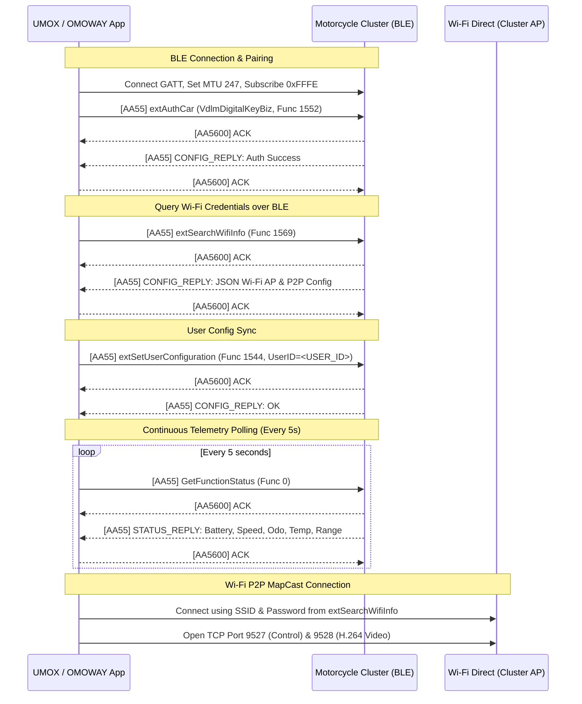

# OMOWAY Bluetooth Low Energy (BLE) & Telemetry Protocol Specification

> **Discovered & Verified**: Reverse-engineered from live sessions with the official OMOWAY Android app (`com.omoway.app.android`) and OMOWAY motorcycle cluster hardware (`OMOWAY[SERIAL_NUMBER]`, MAC `<TARGET_BLE_MAC>`).

---

## 1. BLE GATT Service & Characteristics Architecture

The motorcycle cluster advertises as `OMOWAY[12-digit-serial]` (e.g. `OMOWAY[SERIAL_NUMBER]`).

| Component | UUID | Type / Flags | Purpose |
|---|---|---|---|
| **Service** | `0000fff0-0000-1000-8000-00805f9b34fb` (`0xFFF0`) | Primary Service | Desay SV VDLM Digital Key & Vehicle Bus |
| **Write Characteristic** | `0000fffd-0000-1000-8000-00805f9b34fb` (`0xFFFD`) | WRITE, WRITE_NO_RESP | Phone $\rightarrow$ Motorcycle Command Stream |
| **Notify Characteristic**| `0000fffe-0000-1000-8000-00805f9b34fb` (`0xFFFE`) | NOTIFY, READ | Motorcycle $\rightarrow$ Phone Telemetry & Reply Stream |
| **CCCD Descriptor** | `00002902-0000-1000-8000-00805f9b34fb` | Descriptor | Enable Notifications (`0x0001`) |

### Connection Parameters
* **Target MTU**: `247` bytes (Requested via `gatt.requestMtu(247)` upon connect).
* **Connection Interval**: 12 (15 ms), Latency: 0, Timeout: 1800 (18 s).

---

## 2. Low-Level Link Framing (`AA55` / `AA56`)

All data exchanged over characteristics `0xFFFD` and `0xFFFE` is encapsulated in link-layer frames:

### Frame Types

1. **Data Frame (`AA55`)**:
   ```
   [0..1] Magic Prefix: 0xAA 0x55
   [2..3] Frame Control & Length:
          - If multi-frame: 0x40 | seq_no + length
          - If single-frame: 0x00 + payload_length (1 byte)
   [4..N] Payload (Protobuf message + AEAD/MAC authentication)
   ```

2. **Acknowledgment Frame (`AA56`)**:
   ```
   [0..1] Magic Prefix: 0xAA 0x56
   [2]    Status / ACK Code: 0x00 (Success)
   ```
   - When Phone transmits a frame on `0xFFFD`, the Motorcycle replies with `AA5600` on `0xFFFE`.
   - When Motorcycle transmits a frame on `0xFFFE`, the Phone sends `AA5600` on `0xFFFD`.

---

## 3. High-Level Protocol Lifecycle



---

## 4. Key Exchange: Wi-Fi Direct Info over BLE (`extSearchWifiInfo`)

The motorcycle dynamically generates and returns its Wi-Fi credentials in response to Function ID **`1569` (`0x0621`)**:

### JSON Response Payload:
```json
{
  "version": "2.0",
  "bt_info": {
    "bt_name": "omo-<BLE_SUFFIX>",
    "mac": "<TARGET_BLE_MAC>",
    "state": "enable"
  },
  "ap_config": {
    "ssid": "DIRECT-OMO-<WIFI_SUFFIX>",
    "password": "<WIFI_PASSWORD>",
    "security_type": "WPA-PSK",
    "frequency_band": "5GHz",
    "ip_address": "192.168.2.1",
    "state": "enable"
  },
  "p2p_config": {
    "device_name": "DIRECT-OMO-<WIFI_SUFFIX>",
    "device_address": "<TARGET_P2P_MAC>",
    "group_owner_intent": 15,
    "operating_channel": 149,
    "ip_address": "192.168.2.1",
    "state": "enable"
  }
}
```

> **Direct Connection**: Because `ap_config` includes both the `ssid` and WPA2 `password`, the client app can connect directly via standard Android `WifiNetworkSpecifier` or `WifiConfiguration` without relying on unpredictable Wi-Fi Direct WPS handshake dialogs!

---

## 5. Vehicle Telemetry & Function ID Dictionary

In `STATUS_REPLY` (`VdlmDigitalKeyBiz$GetFunctionStatusReply`), the motorcycle returns telemetry status maps:

### 1. Battery, Range, and Power (`vehicleOtherMap`)

| Function ID | Hex | Metric Name | Raw Value Format | Example Value | Decoded Meaning |
|---|---|---|---|---|---|
| **1026** | `0x0402` | `batteryPercent` / `vehicleBattry` | Integer (0-100) | `80` | **Battery SoC: 80%** |
| **1028** | `0x0404` | `rangeKm` / `vehicleDrivingRange` | Integer (km) | `173` | **Remaining Range: 173 km** |
| **1025** | `0x0401` | `vehicleRestChargingTime` | Minutes / Seconds | `21180` | Time until fully charged |
| **1032** | `0x0408` | `batteryMode` / `chargePower` | Integer | `80` | Battery health / charge mode |
| **1040** | `0x0410` | `veh_speed` | Integer (km/h) | `0` | Vehicle speed: 0 km/h |
| **1056** | `0x0420` | `veh_ntc_temperature_status` | Integer Enum | `0` | Temperature status (0 = Normal) |
| **1088** | `0x0440` | `veh_bus_voltage` / `pressure` | Integer (scaled x10) | `1081` | Bus Voltage / System level |
| **2305** | `0x0901` | `veh_total_mileage` | Integer (km) | `1986` / `2034` | **Odometer: 2,034 km** |
| **2308** | `0x0904` | `veh_tire_press_f` | Integer (bar scaled) | `1` | Front tire pressure normal |
| **2312** | `0x0908` | `veh_tire_press_r` | Integer (bar scaled) | `0` | Rear tire pressure |
| **2336** | `0x0920` | `isVehicleUnlocked` | Boolean (0/1) | `1` | Lock status |
| **2368** | `0x0940` | `veh_sleep_status` | Integer (0/1) | `0` | 0 = Awake, 1 = Sleeping |
| **1168** | `0x0490` | `gear_mode` | Integer Enum | `2` | Drive mode / Gear (Park/Drive) |

### 2. Vehicle Controls (`vehicleFunctionMap`)

| Function ID | Hex | Control Item | Values |
|---|---|---|---|
| **1** | `0x0001` | Main Lock / Unlock | `0` = Unlocked, `1` = Locked |
| **2** | `0x0002` | Seat Trunk Lock | `0` = Open / Unlocked, `1` = Locked |
| **4** | `0x0004` | Power / Ignition Switch | `0` = Off, `1` = On |
| **32** | `0x0020` | Vehicle Search / Horn Beep | `0` = Inactive, `1` = Beeping |

### 3. User Vehicle Settings (`vehicleSettingMap`)

| Function ID | Hex | Setting Item | Default / Stored Value | Meaning |
|---|---|---|---|---|
| **513** | `0x0201` | `usr_welcome_light_setting` | `2` | Welcome light mode |
| **514** | `0x0202` | `usr_follow_home_setting` | `0` | Follow-me-home headlight delay |
| **528** / **1152** | `0x0210` | `usr_auto_lock_setting` | `300` | Auto-lock timeout in seconds (5 minutes) |
| **1537** | `0x0601` | `usr_power_restriction_status`| `128` | Power limitation mode |
| **1538** | `0x0602` | `usr_anti_theft_alarm_setting`| `1` | Anti-theft motion alarm enabled |
| **1600** | `0x0640` | Auto-unlock proximity sensor | `1` | Smart Key proximity auto-unlock |
