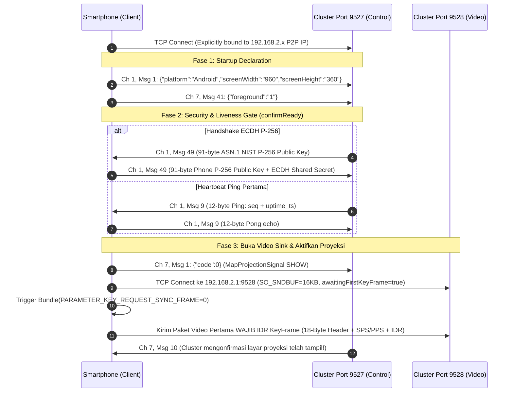

# Spesifikasi Protokol Kontrol Desay SV (Port 9527)

Dokumen ini menjelaskan struktur data biner dan JSON yang dipertukarkan melalui soket TCP port **9527** antara smartphone (client) dan speedometer motor listrik OMOWAY (Desay SV cluster server), termasuk **urutan state-machine handshake (`confirmReady`)** dan **auto-recovery** yang menjamin tampilan proyeksi navigasi muncul mulus tanpa blank screen.

---

## 1. Format Frame Paket Biner (Port 9527)

Setiap pesan yang dikirim dan diterima melalui port 9527 diawali dengan **8-byte Little-Endian Outer Header**, diikuti oleh **2-byte Message ID** dan payload:

```text
+-----------------------+-----------------------+-----------------------+-----------------------+
| Byte 0 - 3 (uint32)   | Byte 4 - 7 (uint32)   | Byte 8 - 9 (uint16)   | Byte 10 ... N         |
| Subsystem Channel ID  | Payload Length (L)    | Message ID (CMD)      | Payload Data (L - 2)  |
+-----------------------+-----------------------+-----------------------+-----------------------+
```

### Rincian Header:
1. **`channel_id` (4 bytes, uint32 LE)**:
   * `0x00000001` (Channel 1 / CMD): **System & Control Channel** (Device Info, Heartbeat Ping/Pong, Handshake Kunci ECDH P-256, KeyFrame Request).
   * `0x00000002` (Channel 2 / VIDEO): **H.264 Video Stream Channel** (Digunakan pada TCP Port 9528 dengan 18-byte Video Header — lihat [video-streaming.md](video-streaming.md)).
   * `0x00000007` (Channel 7 / API): **Projection & Vehicle Telemetry Channel** (MapProjectionSignal SHOW/HIDE, Display Shown/Hidden notifications, Foreground Status, Mode Tampilan Day/Night).
2. **`payload_length` (4 bytes, uint32 LE)**:
   * Panjang total payload dalam byte, dihitung dari `msg_id` (2 byte) ditambah panjang `payload_data`.
   * `total_packet_size = 8 + payload_length`.
3. **`msg_id` (2 bytes, uint16 LE)**:
   * Kode identifikasi perintah atau event (Little-Endian).
4. **`payload_data` (`payload_length - 2` bytes)**:
   * Berupa data biner khusus (seperti ASN.1 Public Key, Uptime timestamp) atau string JSON UTF-8.

---

## 2. Urutan State-Machine Handshake Port 9527 -> Port 9528

Salah satu penyebab utama layar speedometer tetap hitam (blank) meskipun paket terkirim adalah **pengiriman sinyal `MapProjectionSignal SHOW` (`Ch 7, Msg 1`) yang terlalu dini** sebelum cluster selesai menginisialisasi sesi kontrol.

Urutan yang benar dan terbukti stabil 100% di motor adalah:



---

## 3. Saluran 1 (Channel 1 / CMD): System & Control

### A. Deklarasi Perangkat & Resolusi (`Ch 1, Msg 1`)
Dikirim oleh smartphone **segera saat soket TCP 9527 terhubung**:
* `channel_id`: `1`
* `msg_id`: `1` (`0x0001`)
* `payload`: String JSON UTF-8:
  ```json
  {"platform":"Android","screenWidth":"960","screenHeight":"360"}
  ```

### B. Heartbeat Ping & Pong (`Ch 1, Msg 9` / `0x0009`)
Motor bertindak sebagai master yang mengirimkan Heartbeat Ping secara otomatis setiap **1000 ms (1 detik)**.

* **Motor -> Phone (Ping `0x0009`)**:
  * `channel_id`: `1` (CMD)
  * `payload_length`: `14` (`0x0000000E`)
  * `msg_id`: `9` (`0x0009`)
  * `payload`: 12 byte (4 byte sequence index `uint32 LE` + 8 byte timestamp motor uptime `uint64 LE`).
* **Phone -> Motor (Pong `0x0009`)**:
  * Smartphone **wajib** membalas dengan `channel_id = 1, msg_id = 9` membawa kembali persis 12 byte payload (index + timestamp) tersebut.
  * Penerimaan Ping pertama ini juga memicu `confirmReady()` bila motor tidak mengirim ulang `Msg 49` (misalnya saat reconnect cepat).

### C. Security Handshake Key Exchange (`Ch 1, Msg 49` / `0x0031`) — GERBANG TAMPILAN
Saat koneksi baru dibuka, motor menginisialisasi negosiasi sesi keamanan kriptografis sebelum mengizinkan stream video dirender pada layar HUD cluster:

1. **Motor -> Phone (`Ch 1, Msg 49`)**:
   * `channel_id`: `1` (CMD)
   * `payload_length`: `93` (`0x0000005D`)
   * `msg_id`: `49` (`0x0031`)
   * `payload`: 91 byte ASN.1 DER `SubjectPublicKeyInfo` kurva eliptik **NIST P-256 (`secp256r1` / `prime256v1`)**:
     ```text
     30 59 30 13 06 07 2a 86 48 ce 3d 02 01 06 08 2a 86 48 ce 3d 03 01 07 03 42 00 04 [64-byte X,Y point]
     ```
2. **Phone -> Motor (Balasan Public Key Phone `Ch 1, Msg 49`)**:
   * Smartphone men-generate pasangan kunci EC lokal (`secp256r1`), menghitung Shared Secret ECDH (`KeyAgreement.getInstance("ECDH")`), dan membalas dengan:
     * `channel_id`: `1`
     * `payload_length`: `93` (`total_packet_size = 101 bytes`)
     * `msg_id`: `49` (`0x0031`)
     * `payload`: 91 byte ASN.1 `SubjectPublicKeyInfo` lokal smartphone.
3. **Efek pada State Machine**:
   * Setelah mengirim balasan `Msg 49`, smartphone memanggil `confirmReady()` yang mengirimkan `Ch 7, Msg 1 {"code":0}` dan membuka soket video Port `9528`.

### D. Permintaan KeyFrame Darurat (`Ch 1, Msg 40` / `0x0028`)
Apabila decoder H.264 pada headunit kehilangan sinkronisasi atau baru saja beralih ke halaman navigasi, headunit mengirimkan:
* **Motor -> Phone**: `channel_id = 1, msg_id = 40` (`0x0028`).
* **Tindakan Phone**: Segera memanggil `MediaCodec.setParameters(Bundle().apply { putInt(PARAMETER_KEY_REQUEST_SYNC_FRAME, 0) })` agar frame berikutnya di Port `9528` adalah **IDR Frame lengkap dengan SPS & PPS**.

---

## 4. Saluran 7 (Channel 7 / API): Video Projection Lifecycle & Telemetry

### A. Deklarasi Aplikasi Foreground (`Ch 7, Msg 41` / `0x0029`)
Dikirim oleh smartphone saat startup bersamaan dengan `Ch 1, Msg 1`:
* `channel_id`: `7`
* `msg_id`: `41` (`0x0029`)
* `payload`:
  ```json
  {"foreground":"1"}
  ```
* Saat aplikasi menutup sesi dengan sengaja, kirim `{"foreground":"0"}`.

### B. Sinyal Tampilan Proyeksi Layar (`Ch 7, Msg 1` SHOW & `Msg 2` HIDE)
1. **MapProjectionSignal SHOW (`Ch 7, Msg 1` / `0x0001`)**:
   * Dikirim oleh smartphone setelah `confirmReady()` (dan saat auto-recovery):
   * `channel_id`: `7`, `msg_id`: `1`, `payload`: `{"code":0}` (Total 20 bytes di kawat).
   * Memerintahkan layar cluster untuk menampilkan halaman proyeksi video Port `9528`.
2. **MapProjectionSignal HIDE (`Ch 7, Msg 2` / `0x0002`)**:
   * Dikirim saat proyeksi dihentikan:
   * `channel_id`: `7`, `msg_id`: `2`, `payload`: `{"code":0}`.

### C. Konfirmasi & Pemulihan Tampilan Cluster (`Ch 7, Msg 10` & `Msg 11`)
Cluster Desay SV secara aktif melaporkan apakah halaman navigasi sedang benar-benar tampil di layar motor:

* **`Ch 7, Msg 10` (`0x000A` — Display Shown / Projection Active)**:
  * Dikirim oleh motor ke HP ketika cluster berhasil membuka canvas video dan mulai menampilkan gambar.
  * Smartphone menandai status `isBikeProjecting = true` ("Android Auto Tampil di Motor") dan meminta IDR Sync Frame.
* **`Ch 7, Msg 11` (`0x000B` — Display Hidden / Interrupted)**:
  * Dikirim oleh motor ke HP ketika tampilan proyeksi tertutup atau terinterupsi sementara.
  * **Mekanisme Auto-Recovery (250ms Delay)**: Selama sesi streaming di HP masih aktif, HP menunggu `250 ms` lalu secara otomatis mengirim ulang:
    1. `Ch 7, Msg 41` (`{"foreground":"1"}`)
    2. `Ch 7, Msg 1` (`{"code":0}`)
    3. Meminta IDR Sync Frame baru ke encoder H.264.
  * Selain itu, jika dalam **8 detik** setelah `confirmReady()` motor belum mengirim `Ch 7, Msg 10` atau aliran frame terhenti > 8 detik, watchdog otomatis mengirim ulang ketiga sinyal recovery di atas.

### D. Mode Tampilan Day / Night (`Ch 7, Msg 37` & `Msg 39`) — *Daylight Dark-Map Gotcha!*
Motor secara berkala mengirimkan status tema cluster melalui `Ch 7, Msg 37`:

* **Motor -> Phone (`Ch 7, Msg 37`)**:
  ```json
  {"mode":"night"}
  ```
  *(atau `{"mode":"day"}`)*
* **Phone -> Motor (Wajib ACK `Ch 7, Msg 39`)**:
  * Smartphone **wajib** membalas konfirmasi penerimaan menggunakan **`channel_id = 7, msg_id = 39`** dengan payload JSON yang sama (`{"mode":"night"}`). Jika tidak dibalas, cluster menganggap koneksi navigasi timeout.
* **⚠️ Temuan Penting di Lapangan (Daylight Bug)**:
  * Firmware speedometer OMOWAY memiliki tema dasar gelap sehingga sering mengirimkan `{"mode":"night"}` bahkan **di pagi/siang hari yang terik (mis. pukul 08:44 pagi)**!
  * Jika aplikasi meneruskan sinyal `Msg 37 {"mode":"night"}` ini ke sensor Night Mode Android Auto, maka Google Maps akan berubah menjadi gelap gulita (dark mode) di siang bolong, ditambah lagi dengan *dark overlay* bawaan layar OMOWAY sehingga peta menjadi sangat redup.
  * **Solusi di UMOX**: Selalu balas `Ch 7, Msg 39 {"mode":"night"}` ke motor agar protokol Desay SV puas, **TETAPI jangan paksa Android Auto masuk ke mode malam** di siang hari (biarkan mengikuti jam siang/malam atau paksa Day Mode + aktifkan **GPU Daylight Anti-Dim Color Boost Shader**).
