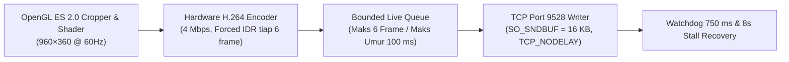

# Spesifikasi Video Streaming H.264 60 FPS Zero-Delay (Port 9528)

Dokumen ini menjelaskan arsitektur lengkap kompresi, *framing* biner 18-byte, manajemen antrean *real-time*, *safe margin* HUD, serta rekayasa *shader* GPU yang membuat transmisi video ke layar speedometer motor listrik **OMOWAY (Desay SV Linux Cluster `960×360`)** berjalan sangat mulus (**60 FPS, Zero-Delay, Anti-Freeze**) melalui soket TCP port **9528**.

---

## 1. Mengapa Stream Sebelumnya Blank atau Delay? (Temuan Kunci Reverse-Engineering)

Dari hasil bedah protokol `Desay SV MapCast` dan pengujian langsung di motor OMOWAY, terdapat **5 penyebab utama** mengapa implementasi *naive* menghasilkan layar gelap (*blank*) atau jeda (*lag*) beberapa detik:

1. **Header Video 18-Byte (Bukan 8-Byte Biasa!)**:
   * Port `9528` **tidak** langsung berisi byte H.264 mentah setelah 8-byte header `[Channel=2][Length]`.
   * Di dalam payload `Channel 2`, wajib terdapat **10-byte Inner Video Header** (`[Codec=1 (1B)][FrameType=1|2 (1B)][PtsUs (8B LE)]`). Tanpa 10 byte ini, *parser* decoder hardware Desay SV menolak seluruh NALU sehingga layar tetap hitam meskipun ribuan paket terkirim!
2. **Injeksi SPS & PPS Berprefiks Panjang 2-Byte pada Setiap IDR (`FrameType == 1`)**:
   * Saat mengirim *Keyframe* (`FrameType = 1`), decoder Desay SV mewajibkan penyisipan `SPS` dan `PPS` yang diawali panjang masing-masing dalam `uint16 Little-Endian`:
     `[spsLen (2B LE)][SPS Bytes][ppsLen (2B LE)][PPS Bytes][IDR Annex-B Slice]`.
3. **Gerbang Paket Pertama Wajib IDR (`awaitingFirstKeyFrame`)**:
   * Paket pertama yang ditulis ke Port `9528` setelah koneksi terbuka (atau setelah antrean di-*flush*) **wajib** berupa `FrameType = 1` (IDR + SPS + PPS). Jika paket pertama adalah *P-Frame* (`FrameType = 2`), decoder hardware tidak memiliki parameter gambar dan gagal menginisialisasi permukaan video.
4. **Bufferbloat di Kernel OS Android (`SO_SNDBUF`)**:
   * Ukuran buffer kirim TCP bawaan Android (512 KB – 2 MB) menampung puluhan frame lama saat sinyal Wi-Fi Direct berfluktuasi, menyebabkan *lag* 2–5 detik. Buffer soket wajib dipangkas menjadi **16 KB (`SO_SNDBUF = 16384`)** dikombinasikan dengan **Bounded Live Queue (maksimum 6 frame / umur maksimum 100 ms)**.
5. **Rute Jaringan Dibelokkan ke 4G/5G oleh Android**:
   * Karena grup Wi-Fi Direct `DIRECT-OMO-*` (`192.168.2.1`) tidak memiliki koneksi internet (`NET_CAPABILITY_VALIDATED = false`), Android otomatis membelokkan `Socket.connect("192.168.2.1", 9528)` ke jalur Data Seluler (4G/5G). Soket TCP wajib di-*bind* secara eksplisit ke antarmuka Wi-Fi Direct (`p2p-wlan0-*` / subnet `192.168.2.x`).

---

## 2. Struktur Eksak Paket Video Desay SV (Port 9528)

Setiap frame video H.264 yang dikirim ke `192.168.2.1:9528` menggunakan urutan byte **Little-Endian (LE)** berikut:

### A. Paket P-Frame (`FrameType = 2`, Total Header = 18 Byte)

```text
+-----------------------+-----------------------+-------------+-------------+-----------------------+-----------------------+
| Byte 0..3 (uint32 LE) | Byte 4..7 (uint32 LE) | Byte 8 (u8) | Byte 9 (u8) | Byte 10..17 (i64 LE)  | Byte 18 ... Akhir     |
| Channel ID = 2        | InnerLen = 10 + Slice | Codec = 1   | Type = 2    | Timestamp (µs / pts)  | Annex-B P-Frame Slice |
+-----------------------+-----------------------+-------------+-------------+-----------------------+-----------------------+
```

### B. Paket IDR KeyFrame (`FrameType = 1`, Header 18 Byte + SPS/PPS Prefixed)

```text
+-----------------------+-----------------------+-------------+-------------+-----------------------+
| Byte 0..3 (uint32 LE) | Byte 4..7 (uint32 LE) | Byte 8 (u8) | Byte 9 (u8) | Byte 10..17 (i64 LE)  |
| Channel ID = 2        | InnerLen = 10+Cfg+Slc | Codec = 1   | Type = 1    | Timestamp (µs / pts)  |
+-----------------------+-----------------------+-------------+-------------+-----------------------+
| Byte 18..19 (u16 LE)  | Byte 20..M            | M..M+1 (u16)| M+2..K      | Byte K ... Akhir      |
| SPS Length (mis. 22)  | SPS Bytes (00 00 00 01| PPS Length  | PPS Bytes   | Annex-B IDR Slice     |
+-----------------------+-----------------------+-------------+-------------+-----------------------+
```

### Implementasi Referensi (Kotlin — `SocketStreamer.kt`)

```kotlin
val isKey = frame.isKeyFrame && spsToUse.isNotEmpty() && ppsToUse.isNotEmpty()
val extraCfgLen = if (isKey) (2 + spsToUse.size + 2 + ppsToUse.size) else 0
val sliceLen = frame.annexBSlice.size

val packet = ByteBuffer.allocate(18 + extraCfgLen + sliceLen)
    .order(ByteOrder.LITTLE_ENDIAN)
    .apply {
        putInt(2)                                      // [0..3]  Channel = 2 (Video)
        putInt(10 + extraCfgLen + sliceLen)            // [4..7]  Inner payload length
        put(1.toByte())                                // [8]     Codec = 1 (H.264)
        put((if (frame.isKeyFrame) 1 else 2).toByte()) // [9]     1 = IDR KeyFrame, 2 = P-Frame
        putLong(frame.presentationTimeUs)              // [10..17] PTS dalam mikrodetik
        if (isKey) {
            putShort(spsToUse.size.toShort())          // [18..19] Panjang SPS (uint16 LE)
            put(spsToUse)                              // SPS NALU (00 00 00 01 67 ...)
            putShort(ppsToUse.size.toShort())          // Panjang PPS (uint16 LE)
            put(ppsToUse)                              // PPS NALU (00 00 00 01 68 ...)
        }
        put(frame.annexBSlice)                         // Annex-B Video Slice (00 00 00 01 65/41 ...)
    }
    .array()
```

---

## 3. Konfigurasi Hardware Encoder 60 FPS & Forced GOP-6 (`MediaEncoder.kt`)

Untuk mendapatkan respons instan tanpa *blur* saat peta bergerak cepat dan pemulihan < 100 ms apabila ada interferensi Wi-Fi:

| Parameter | Nilai Produksi | Alasan Teknis |
| :--- | :--- | :--- |
| **Resolusi Output** | **`960 × 360` piksel** | Resolusi fisik framebuffer Desay SV |
| **Framerate** | **`60 FPS`** | Animasi peta & kursor *rotary* ekstra halus (16,6 ms/frame) |
| **Bitrate** | **`4.000.000 bps` (4 Mbps CBR)** | Kualitas teks jalan sangat tajam tanpa membanjiri pita Wi-Fi P2P |
| **Forced IDR (GOP)** | **Setiap 6 Frame (`100 ms`)** | Memanggil `PARAMETER_KEY_REQUEST_SYNC_FRAME = 0` setiap 6 frame yang di-*encode* |
| **60Hz Frame Repeater** | **Re-render jika diam `> 30 ms`** | Menjaga aliran paket 60Hz tetap hidup walaupun tampilan peta sedang statis |
| **Normalisasi NALU** | **4-Byte Start Code (`00 00 00 01`)** | Mengubah start code 3-byte (`00 00 01`) menjadi 4-byte & membuang `SEI (6)` / `AUD (9)` |

---

## 4. Arsitektur Anti-Delay: 16KB Socket Buffer, Bounded Live Queue, & Watchdog



1. **16 KB Kernel Send Buffer (`SO_SNDBUF = 16384`)**:
   * Mencegah antrean paket menumpuk di kernel Linux Android saat sinyal Wi-Fi Direct terganggu.
2. **Bounded Live Queue (`MAX_QUEUE_FRAMES = 6`, `MAX_QUEUE_AGE_NS = 100_000_000`)**:
   * Sebelum paket dimasukkan atau diambil dari antrean, umur paket diperiksa. Jika tertahan `> 100 ms` atau melebihi `6 frame`, seluruh antrean lama langsung dikosongkan (`clear()`), flag `awaitingFirstKeyFrame = true` dipasang, dan encoder langsung diminta memancarkan **IDR KeyFrame** baru. Hasilnya: **latensi visual selalu 0 ms (real-time)**.
3. **750 ms Write Watchdog & 8-Detik Frame Stall Recovery**:
   * Thread pengawas (`UMOX-VideoWriteWatchdog`) memantau durasi `OutputStream.write()`. Jika tertahan `> 750 ms`, atau jika jumlah frame terkirim tidak bertambah selama `8 detik`, soket `9527` dan `9528` otomatis di-restart tanpa intervensi pengguna.

---

## 5. Kalibrasi Margin Aman HUD (`840×270`) & Shader Anti-Overlay Gelap Omoway

Pada speedometer fisik OMOWAY, firmware cluster menggambar indikator bawaan (jam, baterai, kecepatan `km/h`) **plus lapisan *overlay* gelap transparan** di atas kanvas video `960×360`:

1. **Margin Aman HUD (`glViewport` di dalam `960×360`)**:
   * Agar elemen UI Android Auto tidak tertutup oleh indikator HUD motor, kanvas `960×360` dibersihkan dengan warna hitam murni (`#000000`), lalu area aktif gambar ditempatkan menggunakan `GLES20.glViewport(x, y, width, height)` yang dapat dikalibrasi secara *real-time*:
     * **Margin Kanan (`120 px`)**: Menghindari angka speedometer besar (`0 km/h`) & indikator lampu di kanan.
     * **Margin Bawah (`45 px`)**: Menghindari bar baterai (`93% 197 km`), status koneksi, dan daya (`0.0 kW`).
     * **Margin Atas (`45 px`)**: Menghindari jam (`08:44`) dan indikator status di bagian atas.
     * **Margin Kiri (`0 px` – opsional)**: Area aktif bersih menjadi **`840 × 270` piksel**.
2. **Rekayasa GPU Fragment Shader Anti-Redup (Lawan Overlay Gelap Omoway)**:
   * Karena lapisan *overlay* gelap bawaan motor meredupkan piksel video sebesar ~35%–45% (membuat peta sulit dilihat di bawah terik matahari siang), setiap piksel diproses secara *real-time* di **OpenGL ES 2.0 Fragment Shader** sebelum masuk ke encoder H.264:
     ```glsl
     vec4 c = texture2D(image, t);
     vec3 rgb = clamp(c.rgb, 0.0, 1.0);
     // 1. Gamma / Shadow Lift (< 1.0 mengangkat area gelap & midtone peta tanpa memecahkan teks putih)
     rgb = pow(rgb, vec3(uGamma));          // Rekomendasi Siang: uGamma = 0.68 (Terik: 0.55)
     // 2. Contrast & Brightness Boost
     rgb = clamp((rgb - 0.5) * uContrast + 0.5 + uBrightness, 0.0, 1.0);
     // 3. Luma-Preserving Saturation Boost agar garis rute biru & rambu tetap menyala tajam
     float luma = dot(rgb, vec3(0.2126, 0.7152, 0.0722));
     rgb = mix(vec3(luma), rgb, uSaturation);
     gl_FragColor = vec4(clamp(rgb, 0.0, 1.0), c.a);
     ```
